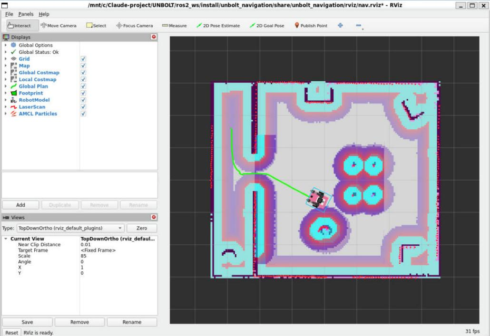
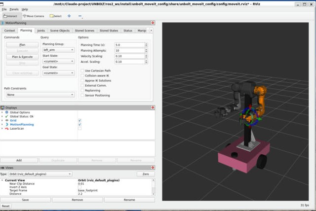
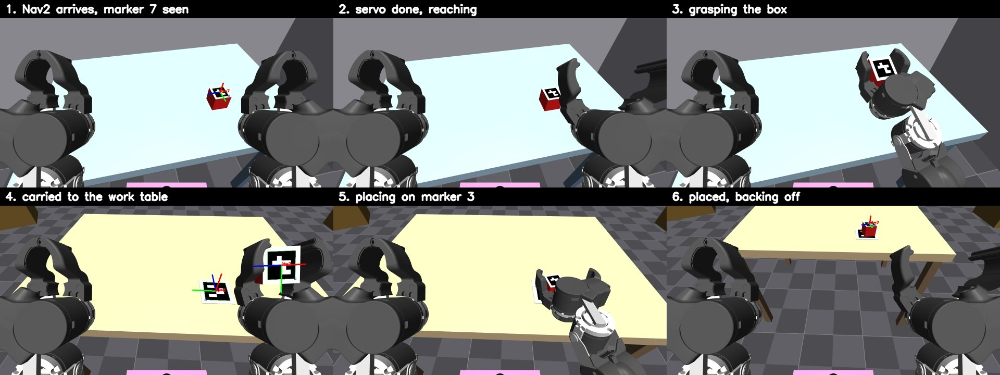
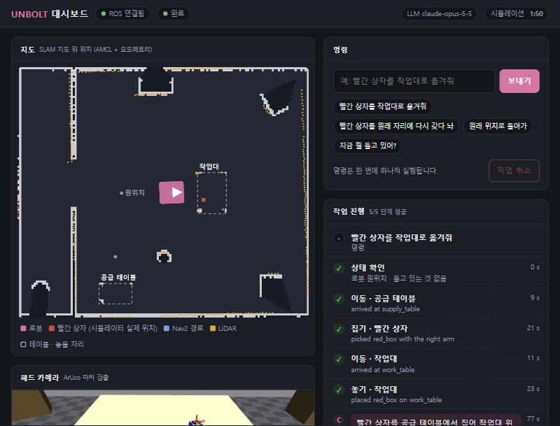

# UNBOLT — ROS 2 + MuJoCo 주행형 양팔로봇

PinkLAB 영상(ROS 2 + MuJoCo 양팔로봇)을 참고해 오픈소스로 재구성하는 프로젝트.

> **강습회 자료**: [workshop/](workshop/README.md) — 2일 과정 실습 교재, WSL이 없는 Windows 노트북부터 시작하는
> [설치 가이드](workshop/00_install.md)와 일괄 설치 스크립트(`workshop/setup/install_unbolt.sh`).

- 환경: WSL2 Ubuntu 22.04, ROS 2 Humble, MuJoCo 3.12 (Python)
- 로봇: 차동구동 베이스 + 기둥 + [OpenArm v2](https://github.com/enactic/openarm_mujoco) 양팔 (7DoF x 2 + 그리퍼)

## 폴더 구조

```
models/
  unbolt_robot.xml   로봇 (차동구동 베이스 + OpenArm 받침대 + 양팔 attach)
  scene.xml          월드 (7x6 m 방, 칸막이벽, 장애물, 공급 테이블, 작업대, 빨간 상자, 마커 3/5/7)
third_party/
  openarm_mujoco/        OpenArm 공식 MJCF (git clone)
  openarm_description/   OpenArm 공식 URDF/xacro (git clone, ros2_ws/src에 심볼릭 링크)
ros2_ws/src/
  unbolt_mujoco_bridge/
    mujoco_bridge_node.py   MuJoCo <-> ROS 2 브리지 (+ 2D LiDAR)
    arm_demo.py             팔/그리퍼 동작 확인용 데모
    launch/bridge.launch.py 시뮬레이터만
    launch/sim.launch.py    시뮬레이터 + robot_state_publisher + RViz
  unbolt_navigation/
    config/slam_toolbox.yaml     slam_toolbox (online async) 설정
    config/nav2_params.yaml      Nav2 (Humble 공식 파일 기반, RPP 컨트롤러, 직사각형 footprint)
    maps/unbolt_room.yaml/.pgm   SLAM으로 만든 지도
    scripts/explore_waypoints.py 지도 작성용 자동 탐색 (ground truth 기반 웨이포인트 주행)
    scripts/nav_goal_test.py     Nav2 목표 3개 연속 주행 + 실제 위치 오차 측정
    launch/slam.launch.py, navigation.launch.py
  unbolt_moveit_config/
    config/unbolt.srdf.base      그룹(left_arm/right_arm/both_arms/그리퍼), 자세(home/ready/open/closed)
    config/unbolt.srdf           = base + 자기충돌 행렬 (scripts/generate_srdf.sh로 생성)
    config/kinematics.yaml, joint_limits.yaml, moveit_controllers.yaml, moveit.rviz
    scripts/generate_collision_matrix.py  MuJoCo로 자기충돌 행렬 계산
    scripts/moveit_test.py       계획+실행 6개 동작 자동 테스트
    launch/moveit.launch.py
  unbolt_manipulation/
    aruco_detector.py            카메라 영상 -> ArUco(DICT_4X4_50) -> TF aruco_<id>
    skills.py                    navigate / servo_to_marker / pick / place 스킬
    pick_place_demo.py           빨간 상자를 공급 테이블 -> 작업대로 옮기는 데모
    task_planner_core.py         Claude 도구 호출 루프 + 스킬을 감싼 도구 + 장소/물체 지식
    task_planner.py, ask.py      ROS 노드(/task_command -> /task_status), 명령 CLI
    launch/bringup.launch.py     sim + Nav2 + move_group + 마커 검출 한 번에
  unbolt_dashboard/
    web/index.html               대시보드 (외부 라이브러리 없음, rosbridge v2 프로토콜 직접 구현)
    dashboard_server.py          웹 서버(:8080) + 지도 PNG/config + /dashboard/robot_pose(TF map->base)
    launch/dashboard.launch.py   rosbridge_websocket(:9090) + 웹 서버
  unbolt_description/
    urdf/unbolt.urdf.xacro      베이스 + OpenArm xacro 매크로 (MJCF와 동일 기구학)
    config/openarm_preset.yaml  OpenArm preset (root를 베이스 위 openarm_body_mount로)
    rviz/unbolt.rviz
    launch/rsp.launch.py, display.launch.py
```

로봇 모델은 MJCF(`models/unbolt_robot.xml`)와 URDF(`unbolt.urdf.xacro`) 두 벌이다.
치수를 바꿀 때는 양쪽을 같이 고쳐야 한다 (주요 값: 바퀴 반지름 0.08, 바퀴 간격 0.45,
받침대 장착 위치 base_link 기준 (-0.05, 0, 0.11), LiDAR (0.22, 0, 0.13)).

## 빌드

처음 설치는 `bash workshop/setup/install_unbolt.sh` (ROS 2, 의존 패키지, OpenArm 모델, 빌드, `~/.bashrc`까지).
코드를 고친 뒤 다시 빌드할 때:

```bash
source /opt/ros/humble/setup.bash
cd <저장소>/ros2_ws
colcon build --symlink-install
source install/local_setup.bash
```

시뮬레이터는 월드 파일을 `$UNBOLT_ROOT/models/scene.xml`에서 찾는다. `UNBOLT_ROOT`가 없으면
`--symlink-install` 링크를 따라 저장소 위치를 알아낸다.

## 실행

```bash
ros2 launch unbolt_mujoco_bridge sim.launch.py               # MuJoCo 뷰어 + RViz (권장)
ros2 launch unbolt_mujoco_bridge sim.launch.py use_viewer:=false rviz:=false
ros2 launch unbolt_mujoco_bridge bridge.launch.py            # 시뮬레이터만
ros2 launch unbolt_description display.launch.py             # 시뮬레이터 없이 URDF만 (관절 슬라이더)
```


### SLAM과 Navigation (3단계)

`slam_toolbox`와 Nav2가 필요하다:

```bash
sudo apt-get install -y ros-humble-slam-toolbox ros-humble-navigation2 ros-humble-nav2-bringup
```

지도 만들기:

```bash
ros2 launch unbolt_navigation slam.launch.py
# 다른 터미널: 키보드로 돌아다니거나 자동 탐색 (약 2분)
ros2 run unbolt_navigation explore_waypoints.py --ros-args -p use_sim_time:=true
# 지도 저장 (src 쪽에 저장한 뒤 colcon build 다시)
ros2 run nav2_map_server map_saver_cli -f $UNBOLT_ROOT/ros2_ws/src/unbolt_navigation/maps/unbolt_room --ros-args -p use_sim_time:=true
```

저장된 지도로 주행 (RViz의 "2D Goal Pose"로 목표 지정):

```bash
ros2 launch unbolt_navigation navigation.launch.py
ros2 run unbolt_navigation nav_goal_test.py --ros-args -p use_sim_time:=true   # 자동 테스트
```



### MoveIt 2 양팔 제어 (4단계)

```bash
sudo apt-get install -y ros-humble-moveit ros-humble-moveit-configs-utils ros-humble-control-msgs
```

```bash
ros2 launch unbolt_moveit_config moveit.launch.py      # MuJoCo + move_group + RViz MotionPlanning
ros2 run unbolt_moveit_config moveit_test.py --ros-args -p use_sim_time:=true   # 자동 테스트
```

- MoveIt은 브리지의 `FollowJointTrajectory` 액션 서버 4개(`left_arm_controller`,
  `right_arm_controller`, `left_gripper_controller`, `right_gripper_controller`)로 궤적을 실행한다.
  ros2_control은 쓰지 않는다.
- 팔은 MuJoCo 액추에이터 중력 보상(`gravcomp` + `actuatorgravcomp`)을 켜서 처짐 없이 목표 각도에 도달한다
  (브리지 파라미터 `arm_gravity_compensation`).
- 끝점(tip)은 손가락 끝의 `openarm_{left,right}_grasp_frame`.
- 그리퍼: `finger_joint1` 0 = 닫힘(끝 간격 3.6 cm), 왼쪽 +0.6 / 오른쪽 −0.6 = 열림(11.5 cm).
- URDF나 SRDF 그룹을 바꾸면 자기충돌 행렬을 다시 만든다:
  `bash src/unbolt_moveit_config/scripts/generate_srdf.sh` 후 `colcon build`.
  (MoveIt Setup Assistant의 `collisions_updater`는 이 로봇에서 멈춰서 MuJoCo로 계산한다.)



### 마커 기반 Pick & Place (5단계)

```bash
ros2 launch unbolt_manipulation bringup.launch.py
ros2 run unbolt_manipulation pick_place_demo --ros-args -p use_sim_time:=true
```

흐름: 팔 `tuck` → Nav2로 공급 테이블 앞 → 마커 7(상자 윗면)로 정밀 접근 → 집기 → 후진 →
Nav2로 작업대 앞 → 마커 3(놓을 자리)로 정밀 접근 → 놓기 → 후진.

- 월드: 공급 테이블(상자 위치)과 작업대(놓을 자리 마커 3), 둘 다 상판 높이 0.65 m.
  OpenArm은 팔이 아래로 늘어진 구조라 전방 파지 도달 범위가 base 기준 x 0.30~0.45 m뿐이어서,
  섀시(높이 0.19 m)가 상판 아래로 들어가는 높이로 정했다.
- 카메라: 받침대 위 헤드 카메라(1280×720, 5 Hz, 47° 하향). 마커 텍스처는 `models/make_markers.py`로 생성.
- 정밀 접근(`servo_to_marker`): 차동구동으로 마커까지의 거리와 방위각을 맞춰 base 기준 목표 위치
  (오른팔 (0.38, −0.15), 왼팔 (0.38, 0.15))에 1 cm 이내로 세운다. 가까이서 마커가 손/상자에 가려지면
  마지막으로 본 위치를 odom 좌표로 기억해 두었다가 오도메트리로 이어서 쓴다.
- 파지: 접근축 15° 하향, 손가락은 base y로 집는다(상자 yaw에 맞춰 ±45° 회전). MoveIt 계획 시 테이블 상판을
  충돌 물체로 넣는다. 운반·접근 중에는 손이 상판과 카메라 시야를 피하도록 팔을 `tuck` 자세로 둔다.



### LLM 작업 계획 (6단계)

자연어 명령 → Claude(`claude-opus-5-5`)가 계획 → 로봇 스킬을 도구로 하나씩 호출 → 결과를 보고 다음 단계 결정.

준비 (WSL, sudo 불필요):

```bash
pip3 install --user anthropic Brotli          # install_unbolt.sh가 이미 설치함
bash workshop/setup/setup_api_key.sh          # 키를 ~/.unbolt_key 에 저장 (~/.bashrc가 읽음), 연결 확인
```

비대화형 셸(스크립트, `bash -c`)에서는 `~/.bashrc`가 앞부분에서 빠져나가므로 `source ~/.unbolt_key`를 직접 하거나
`~/.profile`에 키를 넣는다.

`Brotli`를 함께 올려야 한다: Ubuntu 22.04 기본 `python3-brotli` 1.0.9는 SDK의 HTTP 라이브러리(httpx2)와 맞지 않아
모든 요청이 `APIConnectionError`(원인: `process() takes no keyword arguments`)로 끝난다.

실행:

```bash
ros2 launch unbolt_manipulation bringup.launch.py planner:=true
ros2 run unbolt_manipulation ask "빨간 상자를 작업대로 옮겨줘"
ros2 run unbolt_manipulation ask "빨간 상자를 원래 자리로 갖다 놔"
```

- 도구: `get_world_state`, `navigate_to(location)`, `pick_object(object)`, `place_object(location)`,
  `set_arm_posture(posture)` — 모두 `strict` 스키마, 한 번에 하나씩 실행(`disable_parallel_tool_use`).
- 장소: `supply_table`(놓을 자리 마커 5), `work_table`(마커 3), `home`. 물체: `red_box`(마커 7).
- 진행 상황은 `/task_status`에 JSON 이벤트(command / tool_call / tool_result / thought / final / world)로 나온다.
- 모델이 요청을 거절하면 다른 모델로 자동 재시도하는 server-side fallback(`fallbacks: "default"`)을 켜 두었다.
- API 키 없이 로봇 쪽만 시험: `planner:=true llm:=scripted` (명령의 키워드로 정해진 순서를 재생하는 대역, 계획은 하지 않음).

실제 Claude 시험 (연속 3개 명령, 한 번의 실행):

| 명령 | Claude의 계획 | 결과 |
|---|---|---|
| 빨간 상자를 작업대로 옮겨줘 | world_state → 공급 테이블 이동 → 집기 → 작업대 이동 → 놓기 | 성공, 77 s |
| 파란 공 좀 가져다 줄래? | (도구 호출 없음) 모르는 물건이라 불가, 가능한 일 안내 | 3 s |
| 이제 빨간 상자를 원래 자리에 다시 갖다 놔 | world_state → (이미 작업대 앞) 집기 → 공급 테이블 이동 → 놓기 | 성공, 66 s, 처음 자리에서 0.9 cm |

실패한 시도에서도 Claude는 도구 결과를 읽고 한 번 재시도한 뒤, 상자를 들고 있는 현재 상태를 정확히 보고했다.

### 웹 대시보드 (7단계)

```bash
ros2 launch unbolt_manipulation bringup.launch.py planner:=true dashboard:=true
# 브라우저(Windows에서도 가능): http://localhost:8080/
```

- 지도: SLAM 지도 위에 로봇(외곽선·방향), LiDAR 점, Nav2 경로, 테이블, 빨간 상자(시뮬레이터 실제 위치).
- 헤드 카메라: 마커 검출 결과가 그려진 영상(`/aruco/debug_image/compressed`, JPEG).
- 명령: 자연어 입력, 자주 쓰는 명령 버튼, 작업 취소(`/task_cancel` — 주행·정밀 접근은 즉시 멈추고,
  진행 중인 팔 동작은 마친 뒤 다음 단계를 시작하지 않는다).
- 시스템 종료(헤더 오른쪽, 두 번 눌러 확인): `/dashboard/shutdown` → dashboard_server가 정상 종료(코드 0)하면
  `dashboard.launch.py`가 launch 전체를 끈다(시뮬레이터, Nav2, MoveIt, 플래너, RViz). 서버가 비정상 종료(크래시)하면 끄지 않는다.
  페이지는 "종료했습니다"와 다시 시작 명령을 보여 주고, 다시 켜면 저절로 다시 연결된다.
- 초기화(`/task_reset`, 두 번 눌러 확인): 진행 중인 작업을 취소하고 → 시뮬레이터 리셋(로봇·팔·빨간 상자를
  처음 위치로) → AMCL을 원점으로 다시 맞추고 costmap 비움 → 플래너의 상태(위치·들고 있는 것·마커 기억)도 처음으로.
- 작업 진행: Claude가 호출한 단계마다 상태·걸린 시간·결과, Claude의 응답.
- 로봇 상태: 작업 기준 위치, 들고 있는 물체, 지도 위치, 속도, 양손 그리퍼 열림, 시뮬레이션 시간.
- 페이지를 새로 열면 `/task_world`로 현재 상태를 다시 받아 온다.



대시보드에서 확인한 것: 명령 보내기 → 5단계 완료(76~80 s), 원래 자리로 되돌리기(4단계 완료),
주행 중·정밀 접근 중 취소, 페이지 새로 고침 후 상태 복원, 휴대폰 폭(375 px) 한 열 배치,
초기화(대기 중 2 s / 상자를 들고 주행 중 3 s → 같은 명령 다시 성공, 패드 중심에서 0.5 cm),
시스템 종료(누른 뒤 1.8 s에 페이지가 "종료했습니다", 모든 프로세스 종료, 다시 켜면 페이지 자동 재연결).

다른 터미널에서:

```bash
# 키보드로 주행 (i/j/l/, 등)
ros2 run teleop_twist_keyboard teleop_twist_keyboard

# 팔/그리퍼 데모 (10초)
ros2 run unbolt_mujoco_bridge arm_demo --ros-args -p use_sim_time:=true

# 관절 하나 직접 명령
ros2 topic pub --once /joint_commands sensor_msgs/msg/JointState \
  "{name: [openarm_left_joint1], position: [-0.8]}"

# 월드 리셋 (task_planner가 켜져 있으면: AMCL·플래너 상태까지 함께, 대시보드 초기화 버튼과 같음)
ros2 topic pub --once /task_reset std_msgs/msg/Empty
# 시뮬레이터만 리셋 (planner 없이 실행할 때. 로봇을 움직인 뒤라면 RViz 2D Pose Estimate로 원점을 다시 알려 줄 것)
ros2 service call /mujoco_bridge/reset std_srvs/srv/Trigger
```

브리지 리셋은 시뮬레이션 시간을 0으로 되돌리지 않는다. `/clock`이 뒤로 가면 모든 노드가 TF 버퍼를 비워
Nav2·AMCL·MoveIt이 상태를 잃기 때문이다.

## 브리지 인터페이스

| 방향 | 토픽 | 타입 | 비고 |
|---|---|---|---|
| pub | `/clock` | rosgraph_msgs/Clock | 250 Hz, 시뮬레이션 시간 |
| pub | `/joint_states` | sensor_msgs/JointState | 100 Hz, 팔·그리퍼·바퀴 20개 관절 |
| pub | `/odom` + TF `odom→base_footprint` | nav_msgs/Odometry | 50 Hz, 바퀴 엔코더 적분 |
| pub | `/ground_truth/odom` | nav_msgs/Odometry | 50 Hz, 시뮬레이터 실제 위치 (`world` 프레임) |
| pub | `/imu` | sensor_msgs/Imu | 50 Hz |
| pub | `/scan` | sensor_msgs/LaserScan | 10 Hz, 360빔, 0.12~12 m, 노이즈 σ=1 cm, `lidar_link` 프레임 |
| pub | `/robot_description`, `/tf` | (robot_state_publisher) | URDF 30개 링크 TF |
| sub | `/cmd_vel` | geometry_msgs/Twist | 0.5 s 동안 명령이 없으면 정지 |
| sub | `/joint_commands` | sensor_msgs/JointState | 관절 이름별 위치 목표 (16개) |
| action | `/{left,right}_{arm,gripper}_controller/follow_joint_trajectory` | control_msgs/FollowJointTrajectory | MoveIt 궤적 실행 |
| pub | `/camera/image_raw`, `/camera/camera_info` | sensor_msgs/Image, CameraInfo | 헤드 카메라 5 Hz (그림자·반사 끔) |
| pub | `/ground_truth/red_box` | geometry_msgs/PoseStamped | 상자 실제 위치 (평가용, 스킬은 사용 안 함) |
| srv | `/mujoco_bridge/reset` | std_srvs/Trigger | home 자세로 리셋 (시뮬레이션 시간은 계속 흐름) |

관절 이름: `openarm_{left,right}_joint1..7`, `openarm_{left,right}_finger_joint1`
(finger_joint2는 equality로 joint1을 따라감), `{left,right}_wheel_joint`.

## 진행 상황

- [x] 1단계: MuJoCo 모델 + ROS 2 브리지
- [x] 2단계: URDF/TF, LiDAR, RViz
- [x] 3단계: SLAM + Nav2
- [x] 4단계: MoveIt 2 양팔 제어
- [x] 5단계: 마커 기반 Pick & Place
- [x] 6단계: LLM 작업 계획
- [x] 7단계: 웹 대시보드
