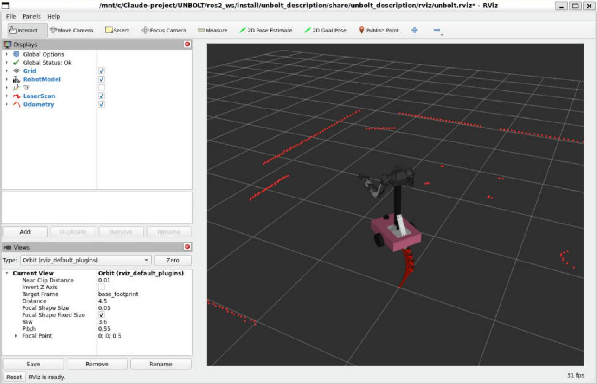

# 설치 가이드: WSL이 없는 Windows 노트북에서 실습 준비 완료까지

**강습회 전에 집에서 끝내 주세요.** 인터넷 속도에 따라 1~2시간 걸리고 약 4 GB를 내려받습니다.
강의실 와이파이로 40명이 동시에 설치하면 몇 시간이 걸릴 수 있습니다.

```
[1] Windows 점검 ─▶ [2] WSL + Ubuntu 22.04 ─▶ [3] 실습 코드 받기 ─▶ [4] 설치 스크립트 ─▶ [5] 점검 ─▶ [6] 첫 실행
     10분               20분 (재부팅 1회)           5분                  10~60분              2분          5분
```

마지막에 `check_env.sh` 결과 화면을 캡처해서 강사가 안내한 곳에 제출하면 끝입니다.

> **표기법**
> - `PS>` 로 시작하는 명령은 **Windows PowerShell**에서 실행합니다.
> - `$` 로 시작하는 명령은 **Ubuntu 터미널**에서 실행합니다. `$`는 입력하지 않습니다.
> - `<...>` 는 본인 값으로 바꿉니다.

---

## 1. Windows 점검 (10분)

### 1-1. Windows 버전

`Win + R` → `winver` 입력 → Enter.

| 결과 | 조치 |
|---|---|
| Windows 11 (모든 버전) | 그대로 진행 |
| Windows 10 버전 21H2 / 22H2 (빌드 19044 이상) | 진행 가능 |
| Windows 10 그 이하 | **설정 → Windows 업데이트**로 최신까지 올린 뒤 진행 |

Windows 업데이트에 밀린 항목이 있으면 먼저 모두 설치하고 재부팅하세요. (WSL 설치 실패 원인 1위)

### 1-2. 가상화가 켜져 있는지

`Ctrl + Shift + Esc`(작업 관리자) → **성능** 탭 → **CPU** → 그래프 아래 정보 칸의 **가상화: 사용**인지 확인.

- **사용** → 다음으로
- **사용 안 함** → [부록 A. BIOS에서 가상화 켜기](#부록-a-bios에서-가상화-켜기)를 먼저 하세요.
- 항목이 아예 없고 "Hyper-V 지원" 같은 항목만 있음 → 이미 다른 가상화가 켜져 있는 것이므로 진행.

### 1-3. 메모리와 디스크

작업 관리자 **성능 → 메모리**에서 전체 용량, 파일 탐색기에서 C: 여유 공간을 확인하세요.

- RAM 16 GB 이상 권장, 8 GB면 [2-4. 메모리 설정](#2-4-메모리가-8-gb인-노트북만-wsl-메모리-설정)을 꼭 하세요.
- C: 여유 30 GB 이상 필요.

### 1-4. (선택) 자동 점검 스크립트

실습 코드를 ZIP으로 받았다면 (`3. 실습 코드 받기`의 방법 B) 위 항목을 한 번에 점검할 수 있습니다.
압축을 푼 폴더의 `workshop\setup` 에서 주소창에 `powershell` 입력 → Enter, 그리고:

```powershell
PS> powershell -ExecutionPolicy Bypass -File .\check_windows.ps1
```

```
== Windows
  [OK]   Microsoft Windows 11 Home (빌드 26200)
== 하드웨어
  [OK]   CPU Intel(R) Core(TM) Ultra 7 258V (8 스레드)
  [OK]   RAM 32GB
  [OK]   C: 여유 216GB
  [OK]   GPU Intel(R) Arc(TM) 140V GPU (16GB) (드라이버 32.0.101.8626)
  [OK]   가상화 사용 중 (하이퍼바이저 동작)
== WSL
  [주의] WSL이 아직 설치되지 않았습니다 (정상, 다음 단계에서 설치)
결과: 실습 가능 (주의 1개)
```

`[실패]`가 있으면 그 줄의 안내를 먼저 해결하세요.

---

## 2. WSL2 + Ubuntu 22.04 설치 (20분, 재부팅 1회)

WSL(Windows Subsystem for Linux)은 Windows 안에서 진짜 리눅스 커널을 돌리는 기능입니다.
가상머신보다 가볍고, **WSLg** 덕분에 MuJoCo·RViz 같은 리눅스 GUI 창이 Windows 창처럼 뜹니다.

### 2-1. 설치 명령

1. 시작 메뉴에서 **PowerShell** 검색 → **관리자 권한으로 실행**
2. 아래 명령 입력:

```powershell
PS> wsl --install -d Ubuntu-22.04
```

3. "요청한 작업이 성공했습니다. 시스템을 다시 시작해야 변경 내용이 적용됩니다" → **재부팅**
4. 재부팅 후 Ubuntu 창이 자동으로 열리고 설치가 이어집니다. (안 열리면 시작 메뉴 → **Ubuntu 22.04**)

> **`wsl --install`을 입력했더니 도움말만 길게 나온다**: 오래된 Windows 10입니다. Windows 업데이트를 하거나,
> Microsoft Store에서 **"Windows Subsystem for Linux"** 와 **"Ubuntu 22.04.5 LTS"** 를 차례로 설치하세요.
>
> **이미 WSL에 다른 Ubuntu가 있다**: 위 명령이 22.04를 **추가로** 설치합니다. 기존 배포판은 그대로 둡니다.
> 기본 배포판 바꾸기: `PS> wsl --set-default Ubuntu-22.04`

### 2-2. 리눅스 사용자 만들기

Ubuntu 창에 다음이 나오면:

```
Enter new UNIX username: student
New password:
Retype new password:
```

- **사용자 이름**: 영어 소문자로 (예: `student`, `hong`). 한글·공백·대문자 불가.
- **비밀번호**: 입력해도 화면에 `*`조차 안 나오는 게 정상입니다. 그대로 치고 Enter.
  이 비밀번호는 `sudo`(관리자 명령)에 계속 쓰이니 **꼭 기억하세요.** Windows 비밀번호와 같을 필요 없습니다.

`student@노트북이름:~$` 같은 프롬프트가 나오면 성공입니다.

### 2-3. 확인

PowerShell(관리자 아니어도 됨)에서:

```powershell
PS> wsl --update
PS> wsl -l -v
```

```
  NAME            STATE           VERSION
* Ubuntu-22.04    Running         2
```

**VERSION이 2**여야 합니다. 1이면: `PS> wsl --set-version Ubuntu-22.04 2`

### 2-4. (메모리가 8 GB인 노트북만) WSL 메모리 설정

WSL은 기본으로 Windows 메모리의 절반만 씁니다. 8 GB 노트북은 4 GB라 모듈 3~4에서 멈출 수 있습니다.
메모장으로 `C:\Users\<윈도우사용자>\.wslconfig` 파일을 만들고 (확장자 `.txt`가 붙지 않게 주의):

```ini
[wsl2]
memory=6GB
swap=8GB
```

저장 후 `PS> wsl --shutdown`, 그리고 Ubuntu를 다시 엽니다. 16 GB 이상이면 건너뛰세요.

### 2-5. 터미널 쓰는 법 (처음이라면)

- **Windows Terminal**을 쓰면 편합니다 (Windows 11 기본 포함, Windows 10은 Store에서 설치).
  탭 옆 `∨` → **Ubuntu-22.04** 로 Ubuntu 탭을 엽니다. 실습에서는 터미널을 3~4개 동시에 씁니다.
- **붙여넣기**: `Ctrl + Shift + V` 또는 마우스 오른쪽 클릭. (`Ctrl + V`는 안 됩니다)
- **실행 중인 프로그램 멈추기**: `Ctrl + C`
- Ubuntu의 홈 폴더를 Windows 탐색기로 열기: `$ explorer.exe .`
- Windows의 C: 드라이브는 Ubuntu에서 `/mnt/c` 입니다.

### 2-6. GUI 창이 뜨는지 (WSLg)

```bash
$ sudo apt update && sudo apt install -y x11-apps
$ xeyes
```

눈알 두 개가 마우스를 따라다니는 창이 뜨면 성공. 창을 닫거나 터미널에서 `Ctrl + C`.
안 뜨면 [문제 해결 – GUI 창이 안 뜬다](troubleshooting.md#gui-창이-안-뜬다-wslg)를 보세요.

✅ **체크포인트 1**: `wsl -l -v`에 `Ubuntu-22.04 … 2`, `xeyes` 창이 뜬다.

---

## 3. 실습 코드 받기 (5분)

코드는 **Ubuntu 홈 폴더의 `~/airlab`** 에 둡니다.
Windows 폴더(`/mnt/c/...`)에 두면 빌드와 실행이 몇 배 느려지니 피하세요.

**방법 A. git clone (권장)**

```bash
$ sudo apt install -y git
$ git clone <강사가 안내한 저장소 주소> ~/airlab
```

**방법 B. ZIP 파일**

강사가 준 ZIP(또는 GitHub의 **Code → Download ZIP**)을 Windows `다운로드` 폴더에 풀었다면:

```bash
$ cp -r /mnt/c/Users/<윈도우사용자>/Downloads/<압축을-푼-폴더> ~/airlab
$ ls ~/airlab
README.md  docs  models  ros2_ws  workshop
```

> `<윈도우사용자>` 이름은 `$ ls /mnt/c/Users` 로 확인할 수 있습니다. 폴더 이름에 공백이 있으면 따옴표로 감싸세요.

---

## 4. 설치 스크립트 실행 (10~60분)

```bash
$ bash ~/airlab/workshop/setup/install_airlab.sh
```

처음에 **sudo 비밀번호**(2-2에서 만든 것)를 한 번 묻습니다. 그다음은 기다리면 됩니다.
노트북 절전 모드가 켜지지 않게 전원을 연결해 두세요.
(새로 설치한 Ubuntu 22.04에서 시험한 결과: 빠른 유선망에서 약 10분, 1,300여 개 apt 패키지. 느린 와이파이는 1시간까지)

스크립트가 하는 일:

| 단계 | 내용 | 시간 |
|---|---|---|
| 0 | Ubuntu 22.04 / 디스크 여유 / 코드 위치 확인 | |
| 1 | 로캘(en_US.UTF-8), curl·git·pip 등 기본 도구 | 1분 |
| 2 | ROS 2 apt 저장소 등록 (`ros2-apt-source` 패키지) | 1분 |
| 3 | ROS 2 Humble Desktop, Nav2, slam_toolbox, MoveIt 2, rosbridge 등 | 20~50분 |
| 4 | Python 패키지: `mujoco==3.12.0`, `anthropic==2.3.0`, `Brotli`, `numpy<2` | 2분 |
| 5 | OpenArm 로봇 모델 2개를 GitHub에서 받기 (고정 커밋) | 2분 |
| 6 | `colcon build`, `~/.bashrc`에 환경 설정 추가 | 1분 |
| 7 | 점검 (`check_env.sh`) | 1분 |

- 중간에 끊겨도 **같은 명령을 다시 실행**하면 이어서 합니다 (이미 된 단계는 건너뜀).
- 빨간 `✘` 로 멈추면 그 메시지로 [문제 해결 문서](troubleshooting.md)를 찾아보세요.

<details>
<summary><b>스크립트가 실제로 실행하는 명령 보기 (직접 따라 치고 싶은 사람, 스크립트가 실패한 사람)</b></summary>

```bash
# 1. 로캘, 기본 도구
sudo apt update
sudo apt install -y locales software-properties-common curl git ca-certificates python3-pip mesa-utils
sudo locale-gen en_US en_US.UTF-8
sudo update-locale LC_ALL=en_US.UTF-8 LANG=en_US.UTF-8
sudo add-apt-repository -y universe

# 2. ROS 2 apt 저장소 (ROS 공식 문서 방식)
export ROS_APT_SOURCE_VERSION=$(curl -s https://api.github.com/repos/ros-infrastructure/ros-apt-source/releases/latest | grep -F "tag_name" | awk -F\" '{print $4}')
curl -L -o /tmp/ros2-apt-source.deb "https://github.com/ros-infrastructure/ros-apt-source/releases/download/${ROS_APT_SOURCE_VERSION}/ros2-apt-source_${ROS_APT_SOURCE_VERSION}.$(. /etc/os-release && echo $VERSION_CODENAME)_all.deb"
sudo dpkg -i /tmp/ros2-apt-source.deb

# 3. ROS 2 + 실습 패키지
sudo apt update && sudo apt upgrade -y
sudo apt install -y ros-humble-desktop ros-dev-tools \
  ros-humble-xacro ros-humble-joint-state-publisher-gui ros-humble-teleop-twist-keyboard \
  ros-humble-slam-toolbox ros-humble-navigation2 ros-humble-nav2-bringup \
  ros-humble-moveit ros-humble-moveit-configs-utils ros-humble-control-msgs \
  ros-humble-rosbridge-server python3-opencv python3-numpy python3-yaml

# 4. Python 패키지 (sudo 없이 ~/.local 에)
pip3 install --user "mujoco==3.12.0" "anthropic==2.3.0" "Brotli>=1.1" "numpy<2"

# 5. OpenArm 모델
cd ~/airlab
git clone https://github.com/enactic/openarm_mujoco.git third_party/openarm_mujoco
git -C third_party/openarm_mujoco checkout a3c8a57ec15d385e3c1dbd3fd090ee486b7f258c
git clone https://github.com/enactic/openarm_description.git third_party/openarm_description
git -C third_party/openarm_description checkout 206eb8a4cf2e5e564536b4f5366ef369843a4aa7
ln -sfn ../../third_party/openarm_description ros2_ws/src/openarm_description

# 6. 빌드, 환경 설정
source /opt/ros/humble/setup.bash
cd ~/airlab/ros2_ws && colcon build --symlink-install
cat >> ~/.bashrc <<'EOF'
# >>> airlab >>>
source /opt/ros/humble/setup.bash
source ~/airlab/ros2_ws/install/setup.bash
export AIRLAB_ROOT=~/airlab
# <<< airlab <<<
EOF
```

왜 이렇게 하는지:

- **`numpy<2`**: ROS Humble의 `cv_bridge` 등은 Ubuntu의 numpy 1.21로 빌드되어 있습니다. pip이 numpy 2.x를
  깔면 `cv_bridge` import가 깨집니다.
- **`Brotli>=1.1`**: Ubuntu 22.04 기본 `python3-brotli` 1.0.9는 anthropic SDK의 HTTP 라이브러리와 맞지 않아,
  모든 API 호출이 `APIConnectionError`로 끝납니다.
- **고정 커밋**: OpenArm 저장소가 업데이트되어 관절 이름이나 메시 경로가 바뀌어도 실습이 깨지지 않게 합니다.
- **`--symlink-install`**: Python 파일과 launch/config 파일을 복사하지 않고 링크하므로, 소스를 고치면 다시 빌드하지
  않아도 바로 반영됩니다 (새 파일을 추가했을 때만 다시 빌드).

</details>

### 4-1. 환경 설정: `~/.bashrc`가 하는 일

`ros2` 명령은 **`source`로 불러온 곳의 패키지만** 압니다. 그래서 두 곳을 모두 불러와야 합니다.

| 불러오는 것 | 그러면 생기는 것 | 없으면 |
|---|---|---|
| `source /opt/ros/humble/setup.bash` | `ros2` 명령, ROS 기본 패키지 (Nav2, MoveIt, RViz) | `ros2: command not found` |
| `source ~/airlab/ros2_ws/install/setup.bash` | 우리가 빌드한 패키지 (`airlab_dashboard` 등) | `Package 'airlab_…' not found` |
| `export AIRLAB_ROOT=~/airlab` | 모델 파일(`models/`) 위치 | 로봇 모델을 못 찾음 |

`~/.bashrc`는 새 터미널이 열릴 때마다 자동으로 실행되는 파일입니다. 설치 스크립트가 이 줄들을
`# >>> airlab >>>` 와 `# <<< airlab <<<` 사이에 넣어 두므로, 새 터미널은 바로 실습 명령을 쓸 수 있습니다.

**확인** (새 터미널에서):

```bash
$ grep -A5 ">>> airlab" ~/.bashrc
$ ros2 pkg prefix airlab_dashboard
/home/student/airlab/ros2_ws/install/airlab_dashboard
$ echo $AIRLAB_ROOT
/home/student/airlab
```

**블록이 없거나, 코드를 `~/airlab`가 아닌 곳에 두었다면** 직접 넣습니다. `REPO`에 실제 코드 위치를 쓰세요.
가장 쉬운 방법은 설치 스크립트를 다시 실행하는 것입니다 (블록을 새로 써 주고, 두 번 들어가지 않습니다).

```bash
$ REPO=~/airlab          # 실제 코드 위치로 바꾸기
$ cat >> ~/.bashrc <<EOF
# >>> airlab >>>
source /opt/ros/humble/setup.bash
source $REPO/ros2_ws/install/setup.bash
export AIRLAB_ROOT=$REPO
# <<< airlab <<<
EOF
$ source ~/.bashrc       # 지금 열린 터미널에도 적용
```

> **이미 열려 있던 터미널은 `.bashrc`를 다시 읽지 않습니다.** 설정을 바꾼 뒤에는 `source ~/.bashrc`를 하거나
> 새 터미널을 여세요. `Package 'airlab_dashboard' not found`는 대부분 이 경우입니다.

**다시 빌드해야 할 때**: `--symlink-install` 덕분에 기존 Python·launch·설정·웹 파일을 고치면 바로 반영됩니다.
새 파일(노드, launch)이나 `setup.py`의 실행 이름을 추가했을 때만 다시 빌드하고 `source`합니다.

```bash
$ cd ~/airlab/ros2_ws && colcon build --symlink-install && source install/setup.bash
```

---

## 5. 점검 (2분)

**새 터미널**을 열고 (또는 `source ~/.bashrc`):

```bash
$ bash ~/airlab/workshop/setup/check_env.sh
```

모든 줄이 `✔`(또는 `!`)이고 마지막 줄이 `0 실패`면 됩니다. 결과 예:

```
시스템
  ✔ Ubuntu 22.04.5 LTS
  ✔ WSL2 커널 5.15.167.4-microsoft-standard-WSL2
  ✔ CPU 8코어
  ✔ WSL 메모리 16GB
  ✔ 코드 위치 /home/student/airlab

화면 (WSLg)
  ✔ WSLg DISPLAY=:0
  ✔ GPU 가속 OpenGL: D3D12 (Intel(R) Arc(TM) 140V GPU (16GB))

ROS 2
  ✔ ROS 2 Humble 설치됨
  ✔ rviz2
  ✔ slam_toolbox
  …
Python
  ✔ mujoco 3.12.0
  ✔ numpy 1.21.5
  ✔ OpenCV 4.5.4 (aruco)
  ✔ anthropic 2.3.0
  ✔ Brotli 1.2.1

AIRLAB 코드
  ✔ third_party/openarm_mujoco @ a3c8a57
  ✔ third_party/openarm_description @ 206eb8a
  ✔ 워크스페이스 빌드됨
  ✔ ~/.bashrc 설정
  ✔ MuJoCo 월드 로드 + 오프스크린 렌더링 (nbody=28 sim=28x img_mean=125)

LLM (모듈 4, 선택)
  ! ANTHROPIC_API_KEY 없음 → llm:=scripted 모드로 실습 가능 (setup_api_key.sh)

결과: 27 통과, 1 경고, 0 실패
```

- `GPU 가속 OpenGL: D3D12 (...)` 대신 `소프트웨어 렌더링: llvmpipe`라고 나오면 동작은 하지만 느립니다.
  Windows에서 그래픽 드라이버를 최신으로 업데이트하고 `PS> wsl --shutdown` 후 다시 점검하세요.
- `sim=…x` 는 물리 시뮬레이션이 실제 시간보다 몇 배 빠른지입니다. 10x 이상이면 충분합니다.

✅ **체크포인트 2**: `0 실패`. 이 화면을 캡처해서 제출하세요.

---

## 6. 첫 실행 (5분)

```bash
$ ros2 launch airlab_mujoco_bridge sim.launch.py
```

창이 두 개 뜹니다.

- **MuJoCo 뷰어**: 방 안에 바퀴 달린 양팔로봇. 마우스 왼쪽 드래그 = 회전, 오른쪽 드래그 = 이동, 휠 = 확대.
- **RViz**: 로봇 모델, 빨간 LiDAR 점, 좌표축(TF).



다른 터미널을 열고 키보드로 몰아 보세요:

```bash
$ ros2 run teleop_twist_keyboard teleop_twist_keyboard
```

`i` 앞으로, `,` 뒤로, `j`/`l` 회전, `k` 정지. (이 터미널 창이 선택된 상태에서 눌러야 합니다)
MuJoCo 뷰어의 로봇이 움직이고 RViz의 LiDAR 점이 따라 바뀌면 설치가 모두 끝난 것입니다.
`Ctrl + C`로 두 터미널을 모두 종료하세요.

✅ **체크포인트 3**: 키보드로 로봇이 움직인다.

### 6-2. (선택) 대시보드 열어 보기

모듈 4에서 쓰는 웹 대시보드도 미리 열어 볼 수 있습니다. Ubuntu 터미널에서 런처를 켜 두고 (이 터미널은 끄지 않기):

```bash
$ ros2 run airlab_dashboard dashboard_launcher
```

Windows 브라우저(Chrome, Edge)에서 <http://localhost:8080> → "ROS가 꺼져 있습니다" 화면에서 옵션을 고르고
**연결 (시스템 시작)**. 25~60초 뒤 "ROS 연결됨"이 뜹니다. API 키가 없으면 LLM을 대역(scripted)으로 고르세요.
끌 때는 오른쪽 위 **시스템 종료**, 런처까지 끄려면 런처 터미널에서 `Ctrl + C`.

`Package 'airlab_dashboard' not found`가 나오면 [4-1. 환경 설정](#4-1-환경-설정-bashrc가-하는-일)을 보세요.

---

## 7. Claude API 키 (모듈 4 전까지, 선택)

모듈 4에서 LLM이 직접 작업을 계획하게 하려면 API 키가 필요합니다. 강사가 키를 나눠 주면 그것을 쓰고,
직접 만든다면:

1. <https://console.anthropic.com> 가입 → **Billing**에서 크레딧 5달러 충전 (강습회 전체에 1~3달러 정도 씁니다)
2. **Settings → Limits**에서 월 사용 한도를 5달러로 걸어 두기 (실수로 많이 쓰는 것 방지)
3. **API Keys → Create Key** → 키 복사 (`sk-ant-`로 시작, 이 화면에서만 볼 수 있음)
4. Ubuntu에서:

```bash
$ bash ~/airlab/workshop/setup/setup_api_key.sh
API 키:                                 ← 붙여넣기(Ctrl+Shift+V) 후 Enter. 화면에 안 보이는 게 정상
✔ ~/.airlab_key 에 저장 (108자, 본인만 읽기 가능)
✔ API 연결 확인: claude-...
```

> **API 키는 비밀번호입니다.** 채팅방·과제 제출물·GitHub·스크린샷에 절대 올리지 마세요.
> 노출됐다면 Console에서 바로 **Delete**하고 새로 만드세요.

키가 없어도 모듈 4의 로봇 동작은 `llm:=scripted` 모드로 똑같이 실습할 수 있습니다.

---

## 8. 있으면 편한 것 (선택)

- **VS Code + WSL 확장**: Windows에 VS Code를 깔고 확장 마켓에서 **WSL**을 설치한 뒤, Ubuntu에서
  `$ code ~/airlab` 를 실행하면 Ubuntu 안의 파일을 Windows의 VS Code로 편집합니다.
- **Ubuntu 파일을 Windows 탐색기에서**: 주소창에 `\\wsl$\Ubuntu-22.04\home\<리눅스사용자>\airlab`

---

## 부록 A. BIOS에서 가상화 켜기

1. 노트북을 재부팅하면서 제조사 로고가 보일 때 BIOS 키를 연타합니다.

   | 제조사 | 키 |
   |---|---|
   | 삼성 | F2 |
   | LG | F2 |
   | Lenovo | F1 또는 F2 (일부는 옆면 Novo 버튼) |
   | HP | Esc → F10 |
   | Dell | F2 |
   | ASUS | F2 또는 Del |
   | MSI | Del |
   | Acer | F2 |

   키를 모르겠으면 Windows에서 **설정 → 시스템 → 복구 → 고급 시작 → 지금 다시 시작 → 문제 해결 →
   고급 옵션 → UEFI 펌웨어 설정**으로도 들어갈 수 있습니다.

2. **Advanced / Configuration / Security** 메뉴에서 아래 중 하나를 찾아 **Enabled**로 바꿉니다.
   - Intel: `Intel Virtualization Technology`, `Intel VT-x`, `VMX`
   - AMD: `SVM Mode`, `AMD-V`
3. **Save & Exit** (보통 F10) → 재부팅 → 작업 관리자에서 **가상화: 사용** 확인.

## 부록 B. 강습회가 끝난 뒤 지우기

Ubuntu 안의 모든 파일(실습 코드, 지도, API 키)이 **영구 삭제**됩니다. 필요한 파일은 먼저 Windows로 복사하세요
(`$ cp -r ~/airlab /mnt/c/Users/<윈도우사용자>/Documents/`).

```powershell
PS> wsl --unregister Ubuntu-22.04
```

API 키도 Console에서 **Delete** 하세요.
