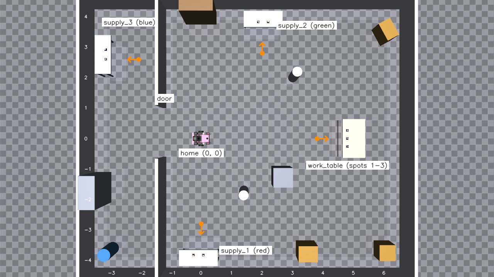

# 모듈 1. MuJoCo + ROS 2 브리지, 주행형 양팔로봇 모델링

**1일차 09:30–11:30 (2시간)**

| 시간 | 내용 |
|---|---|
| 09:30–09:50 | 개념: 왜 MuJoCo인가, 전체 구조 |
| 09:50–10:20 | 실습 1~2: MuJoCo 단독 실행, 모델 파일 읽기 |
| 10:20–10:50 | 실습 3~4: 브리지 실행, 토픽·시간·TF |
| 10:50–11:15 | 실습 5~6: LiDAR, 오도메트리 vs 실제 위치 |
| 11:15–11:30 | 과제 안내, 정리 |

## 학습 목표

1. MuJoCo와 ROS 2를 잇는 **브리지**가 무엇을 해야 하는지 (시간, 상태, 센서, 명령) 설명할 수 있다.
2. 로봇이 **MJCF(MuJoCo)** 와 **URDF(ROS)** 두 벌로 기술되는 이유와 둘을 맞추는 방법을 안다.
3. `/clock`, `/joint_states`, `/odom`, `/scan`, `/tf`를 직접 확인하고 `use_sim_time`의 의미를 안다.
4. LiDAR(레이캐스트)와 휠 오도메트리가 어떻게 계산되는지 코드로 읽는다.

---

## 개념

### Gazebo 대신 MuJoCo

| | Gazebo (Classic/Harmonic) | MuJoCo |
|---|---|---|
| 강점 | ROS 연동 플러그인이 많다, 센서 종류가 많다 | **접촉·마찰 계산이 정확하고 빠르다**, 파이썬으로 바로 쓴다 |
| ROS 연동 | `gazebo_ros` / `ros_gz` 플러그인 | 없음 → **브리지를 직접 만든다** (이 모듈) |
| 쓰임 | 모바일 로봇 시뮬레이션 | 조작(manipulation), 강화학습, 접촉이 많은 작업 |

집기(grasp)처럼 손가락과 물체가 닿는 일이 중요하면 MuJoCo가 유리합니다. 대신 ROS 쪽 연결은 우리가 직접 씁니다.
직접 써 보면 "시뮬레이터가 ROS에 무엇을 내줘야 하는가"를 정확히 알게 됩니다.

### 전체 구조

```
              ┌──────────────────────── mujoco_bridge 노드 (Python, 1개 프로세스) ─────────────────────┐
              │                                                                                    │
 /cmd_vel ───▶│ _apply_commands()   차동구동 역기구학 → 바퀴 속도 액추에이터                        │
 /joint_      │                     관절 목표 → 위치 액추에이터                                     │
 commands ───▶│                                                                                    │
 Follow-      │ mj_step() × N   (1 ms 간격, 실제 시간에 맞춰)                                        │
 JointTraj ──▶│                                                                                    │
              │ _publish_due()  시뮬레이션 시간 기준으로 주기가 된 것만 발행                          │──▶ /clock         250 Hz
              │                                                                                    │──▶ /joint_states  100 Hz
              │                                                                                    │──▶ /odom + TF      50 Hz
              │                                                                                    │──▶ /imu            50 Hz
              │                                                                                    │──▶ /scan           10 Hz
              │ 오프스크린 렌더링 (헤드 카메라)                                                      │──▶ /camera/*        5 Hz
              │ 오프스크린 렌더링 (손목 카메라, wrist_camera_rate > 0일 때만 · 모듈 5)               │──▶ /wrist_camera/* 10 Hz
              └────────────────────────────────────────────────────────────────────────────────────┘
                                                       │ /joint_states
                                   robot_state_publisher (URDF) ──▶ /tf (팔·바퀴 링크 30개)
```

**핵심 규칙 세 가지**

1. **시간의 주인은 시뮬레이터다.** 브리지가 `/clock`을 발행하고, 다른 모든 노드는 `use_sim_time:=true`로
   그 시간을 씁니다. 노트북이 느려서 시뮬레이션이 실제보다 느리게 가도 TF·센서 타임스탬프가 서로 맞습니다.
2. **물리 상태는 MuJoCo, 기구학 트리는 URDF.** 브리지는 관절 각도(`/joint_states`)만 내고,
   링크 사이 좌표 변환(TF)은 `robot_state_publisher`가 URDF로 계산합니다. 그래서 **두 모델의 치수가 같아야** 합니다.
3. **센서는 시뮬레이터 안에서 계산한다.** LiDAR는 MuJoCo의 광선 투사(`mj_ray`), 오도메트리는 바퀴 관절 각도,
   카메라는 MuJoCo 렌더러로 만듭니다. 실제 로봇 드라이버가 내는 것과 같은 토픽·메시지 형태로 냅니다.

### 로봇 구성

```
base_footprint (바닥 투영점)
└─ base_link          차동구동 섀시 0.54×0.38 m, 바퀴 반지름 0.08 m, 바퀴 간격 0.45 m, 캐스터 2개
   ├─ lidar_link       (0.22, 0, 0.13)  2D LiDAR 360빔
   ├─ imu_link
   └─ openarm_body_mount  (-0.05, 0, 0.11)  OpenArm 받침대
      ├─ camera_link → camera_optical_frame   헤드 카메라 (47° 아래를 봄)
      ├─ openarm_left_base_link → link1 … → ee_base_link(손, 손가락 2개) → grasp_frame   7자유도
      └─ openarm_right_base_link → …                                                     7자유도
```

| 파일 | 형식 | 쓰는 곳 |
|---|---|---|
| `models/unbolt_robot.xml` | MJCF | MuJoCo 물리 (질량, 관성, 충돌, 액추에이터) |
| `models/scene.xml` | MJCF | 10 m × 8.5 m 방, 벽, 공급 테이블 3개 · 작업대, 빨강·초록·파랑 상자 + 로봇 `attach` |
| `ros2_ws/src/unbolt_description/urdf/unbolt.urdf.xacro` | URDF/Xacro | TF, RViz, MoveIt, Nav2 footprint |
| `third_party/openarm_mujoco`, `openarm_description` | MJCF, URDF | OpenArm 공식 모델 (팔은 가져다 붙인다) |

팔은 OpenArm 공식 모델을 **그대로 가져와 붙입니다**: MJCF는 `<attach model="bimanual"/>`,
URDF는 xacro 매크로 + preset 파일. 베이스·센서만 우리가 씁니다.

---

## 실습 1. MuJoCo 단독 실행 (ROS 없이)

```bash
$ cd ~/unbolt/models
$ python3 -m mujoco.viewer --mjcf=scene.xml
```

- 오른쪽 패널 **Simulation → Run/Pause**(스페이스바), **Reset**(Backspace)
- 왼쪽 패널 **Rendering → Frame: Body**, **Label: Body** 로 바디 좌표축과 이름 보기
- **Control** 패널의 슬라이더로 바퀴·팔 액추에이터를 직접 움직여 보기
- `Ctrl + 마우스 오른쪽 드래그`로 상자를 끌어 보기 (상자에 더블클릭으로 선택 후)

방 구성 (`models/scene.xml`): x ∈ [−3.5, 6.5] m, y ∈ [−4.25, 4.25] m (약 85 m²). 로봇은 원점에서 +x(동쪽)를 보고 시작합니다.



| 이름 | 위치 (테이블 중심) | 로봇이 서는 곳 (Nav2 목표) | 처음 놓인 것 |
|---|---|---|---|
| `supply_1` 1번 공급 테이블 | 남쪽 벽 (0.0, −3.7) | (0.0, −2.8), 남쪽을 봄 | 빨간 상자 (오른쪽 자리) |
| `supply_2` 2번 공급 테이블 | 북쪽 벽 (2.0, 3.7) | (2.0, 2.8), 북쪽을 봄 | 초록 상자 (오른쪽 자리) |
| `supply_3` 3번 공급 테이블 | 칸막이 너머 서쪽 방 (−2.95, 2.6) | (−2.05, 2.6), 서쪽을 봄 | 파란 상자 (오른쪽 자리) |
| `work_table` 작업대 | 동쪽 (4.8, 0.0) | (3.8, 0.0), 동쪽을 봄 | 비어 있음 (자리 3칸) |

칸막이(x = −1.2)에는 폭 1.6 m짜리 문이 있고, 기둥 2개 · 선반 · 수납장 · 상자 더미 · 사물함 · 통이 장애물입니다.

- 테이블 윗면은 모두 높이 0.65 m입니다. 공급 테이블은 1.2 m × 0.5 m, 작업대는 1.2 m × 0.7 m입니다.
- 놓는 자리마다 10 cm짜리 ArUco 마커 패드가 있습니다: 작업대 **1 · 2 · 3** (로봇이 볼 때 왼쪽 · 가운데 · 오른쪽),
  N번 공급 테이블 **N1 · N2** (오른쪽 · 왼쪽, 예: 1번 테이블은 11 · 12). 상자 윗면 마커는 빨강 **7**, 초록 **8**, 파랑 **9**입니다.
- 테이블 앞다리는 가장자리에서 약 20 cm 안쪽에 있어서, 끝자리를 집으러 옆으로 비껴 서도 차체가 다리에 닿지 않습니다.

> 아무 명령이 없으면 팔이 아래로 처지는 것을 보세요. 브리지는 **중력 보상**(`gravcomp`)을 켜서 이를 막습니다
> (`mujoco_bridge_node.py`의 `load_model()`).

✅ **체크포인트 1-1**: 슬라이더로 바퀴를 돌려 로봇이 움직인다.

## 실습 2. 모델 파일 읽기

`models/unbolt_robot.xml`을 열어 아래를 찾아보세요 (VS Code: `$ code ~/unbolt`).

| 찾을 것 | 확인할 내용 |
|---|---|
| `<option timestep=...>` | 물리 1스텝 = 몇 초? |
| `<velocity name="left_wheel_vel" ...>` | 바퀴는 **속도** 액추에이터. `kv`, `forcerange` 의미 |
| 캐스터 `geom` 의 `priority="2" condim="1" friction="0 0 0"` | 아래 "알아 두면 좋은 함정" 참고 |
| `<site name="lidar_link" ...>` | LiDAR 위치 (URDF의 `lidar_joint`와 같은지 비교) |
| `<camera name="head_camera" ...>` | `fovy`, 해상도, 방향(`xyaxes`) |
| `<attach model="bimanual" .../>` | 팔을 어디에 붙이는지 |

그리고 `unbolt.urdf.xacro`에서 같은 값(바퀴 반지름 0.08, 간격 0.45, LiDAR (0.22, 0, 0.13),
받침대 (-0.05, 0, 0.11))을 찾아 MJCF와 같은지 확인하세요.

> **알아 두면 좋은 함정: MuJoCo 접촉은 두 geom 중 큰 값을 쓴다.** 캐스터에 `condim="1"`(마찰 없음)을 줘도
> 바닥이 `condim="3"`이면 접촉은 3으로 계산되어 캐스터가 미끄러지지 않고 버팁니다. 그러면 제자리 회전이
> 거의 안 됩니다. `priority="2"`를 주면 우선순위가 높은 쪽 값을 씁니다. 실제로 Nav2가 회전하다 멈추는
> 증상으로 나타났던 버그입니다.

## 실습 3. 브리지 실행과 토픽

터미널 1:

```bash
$ ros2 launch unbolt_mujoco_bridge sim.launch.py
```

터미널 2:

```bash
$ ros2 node list
$ ros2 topic list
$ ros2 topic hz /clock          # 약 250
$ ros2 topic hz /scan           # 약 10
$ ros2 topic echo /joint_states --once
$ ros2 topic info /cmd_vel -v   # 누가 구독하나?
```

시뮬레이션 시간과 실제 시간 비교:

```bash
$ ros2 topic echo /clock --once
$ date +%s
```

`/clock`은 0초부터 시작합니다. 그래서 `use_sim_time:=true`를 안 준 노드는 TF가 "미래/과거" 시간이라며
거부합니다 (`Lookup would require extrapolation` 오류). **이 강습회의 모든 `ros2 run`에
`--ros-args -p use_sim_time:=true`를 붙이는 이유**입니다.

✅ **체크포인트 1-2**: `/clock` 250 Hz, `/scan` 10 Hz가 나온다.

## 실습 4. TF 트리와 RViz

```bash
$ cd ~ && ros2 run tf2_tools view_frames --ros-args -p use_sim_time:=true
$ explorer.exe .                 # Windows 탐색기에서 frames_<날짜>.pdf 열기
```

- `odom → base_footprint`는 누가 발행하나? (브리지, 50 Hz)
- `base_link → openarm_left_link1`은 누가? (`robot_state_publisher`)
- `map`은 아직 없다 → 모듈 2에서 SLAM/AMCL이 `map → odom`을 발행합니다.

RViz에서: 왼쪽 **TF** 표시를 켜고 **Show Names**, 팔 관절 하나를 움직여 보세요.

```bash
$ ros2 topic pub --once /joint_commands sensor_msgs/msg/JointState \
    "{name: [openarm_left_joint1, openarm_left_joint4], position: [-0.8, 1.2]}"
$ ros2 run unbolt_mujoco_bridge arm_demo --ros-args -p use_sim_time:=true    # 10초 데모
$ ros2 service call /mujoco_bridge/reset std_srvs/srv/Trigger                 # 원위치
```

MuJoCo 뷰어와 RViz의 팔이 **똑같이** 움직이면 MJCF와 URDF가 일치하는 것입니다.

✅ **체크포인트 1-3**: `frames_*.pdf`에서 `odom → base_footprint → base_link → …` 트리를 확인했다.

## 실습 5. LiDAR = 광선 360개

`ros2_ws/src/unbolt_mujoco_bridge/unbolt_mujoco_bridge/mujoco_bridge_node.py`의 `_publish_scan()`:

```python
origin = d.site_xpos[self.lidar_site].copy()                              # LiDAR 위치 (월드 좌표)
vec = self.lidar_dirs @ d.site_xmat[self.lidar_site].reshape(3, 3).T     # 360개 방향을 로봇 자세로 회전
for k in range(self.lidar_n):                                             # 광선 하나씩 (360개에 약 1 ms)
    self.lidar_dist[k] = mujoco.mj_ray(m, d, origin, vec[k], LIDAR_GEOMGROUP, 1, -1, self.lidar_geomid)
ranges = self.lidar_dist.copy()
hit = ranges >= 0.0
ranges[hit] += self.rng.normal(0.0, self.lidar_noise, hit.sum())          # 노이즈 σ = 1 cm
ranges[~hit | (ranges > self.lidar_max)] = math.inf                       # 안 맞으면 inf
```

- `LIDAR_GEOMGROUP = [1, 1, 0, 0, 0, 0]`: geom **그룹 0, 1만** 봅니다. 로봇 자신의 몸(다른 그룹)은 안 보이게 해서
  자기 팔을 장애물로 착각하지 않게 합니다.
- 실제 LiDAR는 한 바퀴 도는 동안 시간이 흐르지만 여기서는 360개를 한순간에 쏩니다 (`time_increment = 0`).
- 처음에는 광선 여러 개를 한 번에 쏘는 `mj_multiRay`를 썼는데, MuJoCo 3.12에서 가는 물체 일부를 건너뛰었습니다
  (공급 테이블 다리 두 개가 방 대부분에서 안 보였고, 자동 탐색 중 로봇이 그 다리에 부딪혔습니다). 그래서 광선마다 `mj_ray`를 부릅니다.
  센서가 이상하면 같은 광선을 다른 방법으로 쏘아 비교해 보는 것이 좋은 확인 방법입니다.

**확인**: RViz에서 `LaserScan` 표시의 **Size**를 0.05로 키우고, 키보드로 벽에 다가가 보세요.

```bash
$ ros2 run teleop_twist_keyboard teleop_twist_keyboard
# 정면(0°) 빔의 거리 [m]. ranges는 한 줄짜리 배열이라 쉼표로 나눠서 본다:
# 0번 빔 = 뒤쪽(-180°), 180번 = 정면, i번 빔이 (i+2)번째 줄
$ ros2 topic echo /scan --once --field ranges | tr ',' '\n' | sed -n 182p
```

벽에 다가가면서 이 값이 줄어드는지 확인하세요.

## 실습 6. 휠 오도메트리 vs 실제 위치

`_update_odometry()`는 바퀴 각도 변화로 위치를 적분합니다:

```python
dl = (wheel[0] - self.prev_wheel[0]) * self.wheel_radius     # 왼쪽 바퀴가 굴러간 거리
dr = (wheel[1] - self.prev_wheel[1]) * self.wheel_radius
ds   = (dl + dr) / 2.0                                       # 중심이 간 거리
dyaw = (dr - dl) / self.wheel_sep                            # 회전량
mid  = yaw + dyaw / 2.0                                      # 중간 방향으로 적분 (정확도 ↑)
self.odom_pose = [x + ds * math.cos(mid), y + ds * math.sin(mid), yaw + dyaw]
```

브리지는 비교용으로 시뮬레이터의 **실제 위치**도 냅니다 (`/ground_truth/odom`, 실제 로봇에는 없는 정보).

키보드로 방을 1~2분 돌아다닌 뒤 두 값을 비교해 보세요:

```bash
$ ros2 topic echo /odom --field pose.pose.position --once
$ ros2 topic echo /ground_truth/odom --field pose.pose.position --once
```

차이가 생기는 이유는? (바퀴 미끄러짐, 캐스터 마찰, 급회전) → **이 오차를 LiDAR로 바로잡는 것이 모듈 2의 SLAM/AMCL**입니다.

✅ **체크포인트 1-4**: 오도메트리와 실제 위치의 차이를 cm 단위로 적었다.

---

## 과제

**기본 과제 A. 장애물 추가하기**

1. `models/scene.xml`을 `models/my_scene.xml`로 복사 (같은 폴더에 둬야 상대 경로가 맞습니다).
2. `<worldbody>` 안 정적 장애물들 옆에 상자 하나를 추가합니다:
   ```xml
   <geom name="my_box" type="box" size="0.2 0.2 0.3" pos="1.5 1.0 0.3" rgba="0.2 0.6 0.2 1"/>
   ```
3. 실행: `ros2 launch unbolt_mujoco_bridge sim.launch.py model_path:=$UNBOLT_ROOT/models/my_scene.xml`
4. RViz의 LiDAR에 새 상자가 보이는지 확인. `group="3"`을 주면 어떻게 되는지도 확인하고 이유를 설명하세요.

**기본 과제 B. LiDAR 파라미터**

브리지 노드를 직접 실행해서 빔 수와 노이즈를 바꿔 봅니다:

```bash
$ ros2 run unbolt_mujoco_bridge mujoco_bridge --ros-args \
    -p model_path:=$UNBOLT_ROOT/models/scene.xml -p lidar_samples:=720 -p lidar_noise_std:=0.05
```

`ros2 topic echo /scan --once --field angle_increment` 로 빔 간격(360빔이면 0.01745 rad)이 바뀐 것을 확인하고,
노이즈를 5 cm로 키우면 RViz의 점이 어떻게 보이는지 캡처하세요.

**도전 과제. 범퍼 센서 만들기**

`mujoco_bridge_node.py`에 `/bumper` (`std_msgs/Bool`) 토픽을 추가해서 섀시가 벽·장애물에 닿으면 `True`를
50 Hz로 발행하세요. 힌트: `d.contact[i].geom1/geom2`, `m.geom_bodyid`, `_publish_due()`에 주기 추가.
`colcon build`는 필요 없습니다 (`--symlink-install`). 노드만 다시 실행하세요.

---

## 정리 질문

1. 브리지가 `/clock`을 내지 않으면 Nav2·MoveIt에 어떤 문제가 생길까?
2. URDF의 LiDAR 위치를 MJCF와 다르게 적으면 RViz의 LiDAR 점은 어떻게 보일까?
3. `/joint_states`는 브리지가, `/tf`는 `robot_state_publisher`가 낸다. 브리지가 TF를 전부 직접 내면 안 될까?
4. 시뮬레이션이 실제 시간보다 느려지면 (`simulation is slower than real_time_factor` 경고) 무엇이 달라지고 무엇은 그대로일까?

## 참고 코드

| 파일 | 볼 곳 |
|---|---|
| `unbolt_mujoco_bridge/mujoco_bridge_node.py` | `run()` (스텝 루프), `_apply_commands()`, `_publish_due()`, `_publish_scan()`, `_update_odometry()`, `load_model()` |
| `unbolt_mujoco_bridge/trajectory_server.py` | MoveIt 궤적 실행 (모듈 3) |
| `unbolt_mujoco_bridge/launch/sim.launch.py` | 브리지 + robot_state_publisher + RViz |
| `unbolt_description/urdf/unbolt.urdf.xacro` | 베이스 + OpenArm xacro 매크로 |
