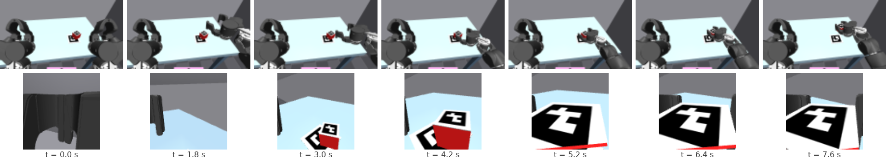
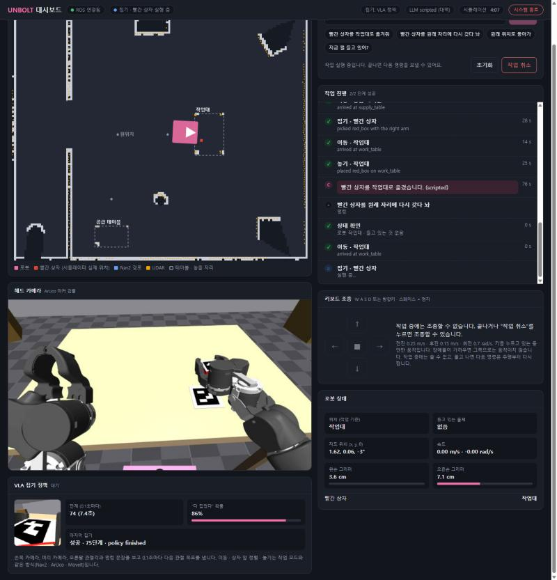

# 심화 모듈 5. VLA: 카메라를 보고 집는 법을 배운 정책

**선택 · 약 2시간 (녹화 13분 + 학습 35분은 기다리는 동안 개념·코드 읽기)**

| 시간 | 내용 |
|---|---|
| 0:00–0:20 | 개념: 지금까지의 "계산해서 집기"와 "배워서 집기", 모방 학습, VLA |
| 0:20–0:40 | 실습 1~2: 전문가 시연 보기, 시연 600개 녹화 (두 테이블) |
| 0:40–1:20 | 실습 3: CPU로 학습 35분 (기다리는 동안 `model.py` 읽기) |
| 1:20–1:40 | 실습 4: 처음 보는 배치에서 평가 |
| 1:40–2:00 | 실습 5: 대시보드 **VLA 집기** 모드로 전체 작업 |

## 학습 목표

1. 모듈 3의 집기(마커 좌표 → IK → MoveIt)와 **학습된 정책의 집기**(이미지 → 관절 목표)가 어떻게 다른지 설명한다.
2. 스크립트 전문가로 시연을 모으고 **모방 학습(behavior cloning)** 으로 정책을 학습해, GPU 없이 노트북 CPU에서 돌려 본다.
3. 학습한 정책을 시뮬레이터에서 **닫힌 루프로 평가**하고, 전문가와 성공률을 비교한다.
4. 정책을 ROS 노드로 감싸 기존 시스템(LLM 계획 · Nav2 · 마커 정렬 · MoveIt 놓기)의 **집기 한 단계만** 바꿔 끼운다.

## 준비

- 모듈 4까지 끝낸 환경 (bringup과 대시보드가 동작)
- PyTorch (CPU판이면 충분, 약 200 MB):

```bash
$ python3 -c "import torch; print(torch.__version__)" || pip install --user torch --index-url https://download.pytorch.org/whl/cpu
```

- 디스크 약 150 MB (`~/unbolt_vla/`에 시연과 정책이 저장됨)

---

## 개념

### 지금 로봇은 어떻게 집고 있나

모듈 3의 `pick()`은 **계산**으로 집습니다.

```
 헤드 카메라 → ArUco 마커 검출 → 상자 위치·방향 (숫자)
            → 손 목표 자세 계산 (접근 15°, 손가락 방향) → MoveIt IK·계획 → 팔 궤적
```

정확하고 설명하기 쉽지만, **마커가 붙은 물체만** 집을 수 있고 물체 모양과 잡는 법을 사람이 코드로 정해 줘야 합니다.

### VLA (Vision-Language-Action)

VLA 정책은 숫자 좌표 없이 **카메라 영상(Vision)과 명령 문장(Language)을 보고 바로 관절 명령(Action)** 을 냅니다.

```
 머리 카메라 128×72 ┐
 손목 카메라 96×96  ├─▶ 신경망 ─▶ 앞으로 1초(10단계) 동안의 오른팔 관절 7개 + 손가락 목표
 명령 "pick up the red box" ┤                  + "다 집었다" 확률
 지금 관절각 8개   ┘         0.1초마다 다시 본다
```

RT-2, OpenVLA, π0 같은 큰 VLA는 수십억 개의 매개변수와 GPU가 필요합니다. 여기서는 같은 구조를
**아주 작게(매개변수 60만 개)** 만들어 노트북 CPU에서 35분 만에 학습합니다.

### 무엇을 학습하고 무엇을 그대로 두나

| 단계 | 작업 모드 | VLA 집기 모드 |
|---|---|---|
| 계획 | LLM (Claude) | 같음 |
| 테이블까지 주행 | Nav2 | 같음 |
| 상자 앞 정렬 | ArUco 마커 정밀 접근 | 같음 (오른팔 기준) |
| **집기** | 마커 좌표 → MoveIt | **정책이 카메라를 보고** (`/joint_commands` 10 Hz) |
| 팔 접기, 놓기 | MoveIt | 같음 |

한 단계만 바꾸면 무엇이 좋아지고 나빠졌는지 정확히 비교할 수 있습니다.

### 모방 학습: 잘하는 사람을 따라 하기

1. **전문가**가 시연합니다. 여기서는 사람 대신 `expert.py`: 시뮬레이터가 아는 상자의 **실제** 위치로 IK를 풀어
   `pick()`과 같은 순서(손 벌리며 다가가기 → 비스듬히 밀어 넣기 → 쥐기 → 들기)로 움직입니다.
2. 시연마다 매 0.1초의 (카메라 영상, 관절각, 명령) → (전문가가 낸 관절 목표)를 기록합니다.
3. 신경망이 같은 입력에서 같은 출력을 내도록 학습합니다 (지도 학습, L1 손실).

정책은 실제 위치를 모릅니다. **영상만 보고** 전문가를 흉내 내야 합니다.

### 작은 차이가 쌓이는 문제와 세 가지 대책

정책이 조금만 틀려도 다음 장면은 시연에 없던 장면이 되고, 거기서 더 틀립니다 (compounding error).

| 대책 | 이 코드에서 |
|---|---|
| **넓게 모으기** | 두 테이블(파란 공급 테이블, 나무색 작업대) × 상자 위치 ±4~6 cm, 방향 ±45°, 로봇 정렬 오차 ±4×5 cm · ±8° 를 무작위로 (`sim.py`의 `TABLES`, `SPREAD`) |
| **흔들어 모으기 (DART)** | 시연 절반은 실제로 보내는 목표에 천천히 변하는 잡음을 더함. 기록하는 정답은 전문가 목표 그대로 → "어긋났을 때 돌아오는 법"이 데이터에 들어감 |
| **묶음으로 내기 (action chunking)** | 1단계가 아니라 10단계를 한 번에 예측하고, 겹치는 예측을 평균(temporal ensembling, ACT 논문) → 떨림이 줄고 한 번의 실수가 덜 퍼짐 |

### 정책의 구조 (`model.py`)

```
 이미지 → 합성곱 4층 → 공간 소프트맥스: 특징 지도 64개 각각이 "가장 강하게 반응한 위치 (x, y)"
                        → 128개 숫자 = "상자는 어디, 손가락은 어디"
 명령 → 단어마다 해시 → 단어 벡터 평균 (32)
 관절각 (8, 정규화)
 → 전부 이어 붙여 MLP 2층 (512) → 관절 목표 10×8 + "끝" 확률
```

공간 소프트맥스는 "어디에 있나"를 직접 숫자로 뽑아서, 위치가 중요한 집기에 적은 데이터로도 잘 맞습니다.
단어 해시는 어떤 문장이 와도 벡터를 만들 수 있게 합니다 (LLM이 보낸 문장도 그대로 들어감).

> **정직한 한계**: 장면에 집을 물체가 빨간 상자 하나뿐이라, 이 정책에서 "언어"는 거의 역할이 없습니다.
> 문장을 바꿔도 같은 동작을 합니다. 물체를 여러 개 두고 명령으로 고르게 하는 것이 도전 과제 3입니다.

---

## 실습 1. 전문가 시연 보기

ROS 없이 MuJoCo만으로 돌아갑니다.

```bash
$ cd ~/unbolt/ros2_ws/src/unbolt_vla
$ python3 -m unbolt_vla.record --episodes 4 --workers 1 --out /tmp/vla_try
4/4 episodes kept in /tmp/vla_try (14 s)
```

시연 하나를 열어 봅니다:

```bash
$ python3 -c "
import numpy as np; z = np.load('/tmp/vla_try/ep_00000.npz')
for k in z.files: print(k, z[k].shape)
print(z['instruction'], '| 끝 표시 단계 수:', z['done'].sum())"
```

```
head (77, 72, 128, 3)       머리 카메라 77장 (7.7초)
wrist (77, 96, 96, 3)       손목 카메라
state (77, 8)               오른팔 관절 7개 + 손가락
action (77, 8)              전문가가 그 순간 보낸 관절 목표
done (77,)                  마지막 0.5초(들고 기다리기)만 1
instruction ()              pick up the box
```



✅ **체크포인트 5-1**: 손목 카메라에 상자가 점점 커지다가 손가락 사이에 들어오는 것을 확인했다.

## 실습 2. 시연 600개 녹화

```bash
$ ros2 run unbolt_vla record --episodes 600
583/600 episodes kept in /home/<you>/unbolt_vla/demos (785 s)
```

8코어 노트북에서 약 13분. 시연마다 상자가 공급 테이블과 작업대 중 한 곳에 놓입니다(`--table supply`/`work`로 한 곳만).
실패한 시연(잡음 때문에 놓쳤거나 IK가 경유점에 닿지 못한 경우)은 저장하지 않습니다. 전부 약 230 MB.

> **왜 두 테이블인가.** 처음에는 공급 테이블에서만 시연 297개를 모아 학습했습니다. 그 정책은 공급 테이블에서 48/50을
> 집었지만, 작업대에서는 **0/20**이었습니다. 나무색 상판과 다른 방향의 방은 정책에게 처음 보는 장면이라, 팔을 조금 움직이다
> 2초 만에 "다 집었다"고 말해 버렸습니다. "원래 자리에 갖다 놔"는 작업대에서 집어야 하므로, 작업대 시연을 더해 다시 학습했습니다.
> 학습된 정책은 **본 것만 할 수 있다**는 것을 보여 주는 실험입니다 (`--table supply`로 녹화해 직접 확인해 보세요).

## 실습 3. 학습

```bash
$ ros2 run unbolt_vla train
525 training episodes (40425 steps), 58 validation episodes
step    500  train 0.1132  val 0.1113  done 0.085  88 s
step   1000  train 0.1024  val 0.0892  done 0.069  186 s
...
step  12000  train 0.0481  val 0.0381  done 0.044  2123 s
best validation L1 0.0381, saved /home/<you>/unbolt_vla/policy.pt
```

- `val`: 학습에 쓰지 않은 시연 58개(두 테이블에서 고루)에서의 오차 (정규화한 관절 단위, 작을수록 좋음)
- `done`: "다 집었다" 판단의 오차
- 검증 오차가 가장 낮을 때마다 `~/unbolt_vla/policy.pt`에 저장

기다리는 동안 `model.py`, `train.py`의 `shift()` · `jitter()`(영상 흔들기, 밝기 바꾸기)를 읽어 보세요.

✅ **체크포인트 5-2**: `val`이 처음보다 크게 줄었고 `policy.pt`가 생겼다.

## 실습 4. 처음 보는 배치에서 평가

학습에 쓰지 않은 무작위 배치 100개(테이블도 무작위)에서 정책과 전문가를 똑같이 시켜 봅니다:

```bash
$ ros2 run unbolt_vla evaluate --episodes 100 --video ~/vla.gif
episode   0  work    policy lifted in  75 steps   expert lifted
...
supply  policy 48/48 (100%)   expert 48/48 (100%)
work    policy 52/52 (100%)   expert 52/52 (100%)
policy 100/100 (100%)   expert 100/100 (100%)   693 s
```

이 저장소에서 학습한 정책(시연 583개, 12000단계, CPU 35분)의 결과입니다. 정책은 전문가와 거의 같은 7~8초에 집습니다.
`--table supply`/`work`로 한 테이블만 시험할 수 있습니다.

같은 방법으로 학습한 결과를 비교하면 무엇이 성공률을 만들었는지 보입니다:

| 학습 데이터 | 공급 테이블 | 작업대 | 실패 모양 |
|---|---|---|---|
| 공급 테이블 시연 297개 | 48/50 (96%) | **0/20** | 공급: 손이 접근 시작 자세에서 **멈춤**(stall) 2번 · 작업대: 2초 만에 "다 집었다" |
| 두 테이블 시연 583개 | 48/48 (100%) | 52/52 (100%) | 없음 |

멈춤은 모방 학습에서 흔한 실패입니다. 전문가의 움직임은 경유점마다 부드럽게 서다가 다시 출발하는데, 정책 입장에서는
"멈춰 있는 장면"에서 "계속 서 있기"도 그럴듯한 답이라 거기에 갇힌 것입니다. 이 실험에서는 시연을 늘리자 사라졌습니다.

✅ **체크포인트 5-3**: 정책의 성공률을 적고, `~/vla.gif`에서 실패한 장면이 있으면 무엇이 달랐는지 찾았다.

## 실습 5. 대시보드 VLA 집기 모드

```bash
$ ros2 run unbolt_dashboard dashboard_launcher
```

http://localhost:8080 → 모드 **VLA 집기 (작업 + 학습된 집기 정책)** → 연결. 터미널에서 직접 켜려면:

```bash
$ ros2 launch unbolt_manipulation bringup.launch.py planner:=true dashboard:=true pick:=vla
```

`pick:=vla`가 하는 일:

| 무엇 | 바뀌는 것 |
|---|---|
| 브리지 | 헤드 카메라 5 → 10 Hz, 손목 카메라 `/wrist_camera/image_raw` 켜기 (정책은 매 단계 새 영상으로 학습) |
| `vla_pick` 노드 | 정책을 불러 `/vla/pick`(명령 문장)을 기다림 → 0.1초마다 `/joint_commands` → 끝나면 `/vla/result` |
| 작업 관리자 | `pick_object`에서 오른팔 기준으로 정렬한 뒤 `pick()` 대신 `vla_pick()` 호출 |

"빨간 상자를 작업대로 옮겨줘"를 보내고, 대시보드의 **VLA 집기 정책** 카드에서 손목 카메라 영상과 "다 집었다" 확률을 보세요.
이어서 "빨간 상자를 원래 자리에 다시 갖다 놔"를 보내면 이번에는 작업대에서 정책이 집습니다.



`vla_pick`은 정책이 "다 집었다"고 말해도 그대로 믿지 않습니다. **손을 닫으라고 명령했고, 손가락이 끝까지 닫히지 못하고
멈췄을 때(물체가 끼어 있음)** 만 성공으로 보고합니다. 처음에는 손가락 각도만 봤는데, 공급 테이블만 학습한 정책이 작업대에서
손을 벌린 채 "다 집었다"고 했을 때 벌린 손도 각도가 커서 성공으로 잘못 보고됐습니다. 학습된 부품의 출력은 이렇게
**다른 신호로 한 번 더 확인**해야 합니다.

✅ **체크포인트 5-4**: VLA 모드에서 상자를 작업대로 옮기고, 다시 원래 자리로 가져다 놓았다.

---

## 과제

**과제 1. 데이터는 얼마나 필요한가.** 시연 50개, 100개로 각각 학습해(`--demos`로 폴더 지정, 파일 일부만 복사)
성공률을 표로 만드세요. 학습 단계 수는 같게 둡니다.

**과제 2. 무엇을 보고 집나.** `model.py`에서 손목 카메라 입력을 0으로 바꿔(`wrist * 0`) 다시 학습하고 평가하세요.
머리 카메라만으로는 왜 어려울까요? (힌트: 시연 사진에서 손이 상자를 가리는 때)

**과제 3. 언어가 의미 있게.** `scene.xml`에 파란 상자를 하나 더 두고, `sim.py`·`expert.py`·`record.py`를 고쳐
"pick up the blue box"면 파란 상자를 집게 하세요. 문장만 보고 고르는지 평가로 확인합니다.

**과제 4. 멈춤 다시 만들고 고치기.** `record --table supply --episodes 300`으로 공급 테이블 시연만 모아 학습하고
`evaluate --table supply`, `--table work`로 평가해 위 표를 재현하세요. 멈춘 배치를 `--video`로 본 뒤 (1) `expert.py`에서
경유점 사이 `smooth()`를 빼 손이 서지 않고 이어서 움직이게, (2) 정책 입력에 "지금까지 걸린 시간"을 넣기 중 하나로
시연 수를 늘리지 않고 멈춤을 줄일 수 있는지 보세요.

**도전 과제. 더 넓은 정렬 오차.** `SPREAD`를 두 배로 늘리고 평가만 다시 하세요 (학습은 그대로). 어디서부터 실패하나요?
그 배치를 시연에 넣어 다시 학습하면 회복되나요?

## 정리 질문

1. 전문가는 상자의 실제 위치를 알고, 정책은 모릅니다. 그런데도 정책이 집을 수 있는 이유는?
2. DART 잡음을 넣을 때 "기록하는 정답"을 잡음 섞인 목표가 아니라 전문가 목표로 두는 이유는?
3. 이 정책을 실제 로봇에 쓰려면 무엇이 문제일까? (렌더링과 실제 카메라 영상의 차이, 조명, 물체 다양성)
4. LLM 계획 + 고전 주행 + 학습된 집기처럼 섞어 쓰는 구조의 장점과 위험은?

## 참고

| 파일 | 내용 |
|---|---|
| `unbolt_vla/sim.py` | 집기 전용 장면: 무작위 배치, 카메라 렌더링, 성공 판정 |
| `unbolt_vla/expert.py` | 스크립트 전문가 (감쇠 최소제곱 IK, `pick()`과 같은 경유점) |
| `unbolt_vla/record.py` | 시연 녹화 (병렬, DART 잡음) |
| `unbolt_vla/model.py`, `train.py` | 정책 구조, 학습 |
| `unbolt_vla/runner.py` | 묶음 예측의 시간 평균(temporal ensembling) |
| `unbolt_vla/evaluate.py` | 닫힌 루프 평가, GIF |
| `unbolt_vla/vla_pick_node.py` | ROS 노드 |
| ACT (action chunking) | Zhao et al., *Learning Fine-Grained Bimanual Manipulation with Low-Cost Hardware*, RSS 2023 |
| DART | Laskey et al., *DART: Noise Injection for Robust Imitation Learning*, CoRL 2017 |
| 공간 소프트맥스 | Levine et al., *End-to-End Training of Deep Visuomotor Policies*, JMLR 2016 |
| 큰 VLA | RT-2 (2023), OpenVLA (2024), π0 (2024) |
